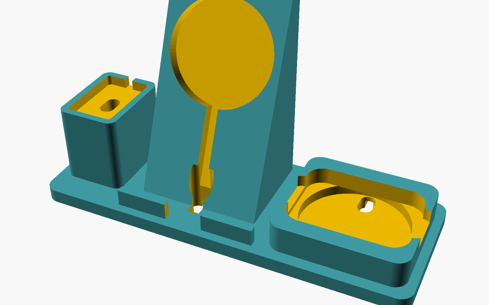

# 3-in-1 charging station: Pixel 10 Pro XL, Pixel Watch 5, Liberty 4 NC



A parametric OpenSCAD design. Edit `charging_station.scad`, then export
an STL. A pre-rendered `charging_station.stl` with the default values is
included.

| Slot | Charger you supply | How it holds |
|---|---|---|
| Phone (centre, 68° stand) | Magnetic Qi2 puck, such as the Google Pixelsnap Charger | The puck sits in a recess. The phone's Pixelsnap magnets hold it on, and a front lip catches the bottom edge. The lip has a gap for the USB-C port. |
| Watch (left pillar, 45 mm tall) | Official Pixel Watch 4/5 Quick Charge Dock (41 × 27 × 9.6 mm) | The dock sits 6 mm deep in a pocket. The pillar is tall so the band hangs free. |
| Earbuds (right well) | Thin round Qi pad (default Ø60 × 6 mm) | The pad sits at the bottom of the well. The case lies on it, and finger notches let you lift it out. |

All three cables drop through holes big enough for a USB-C plug. They run
in grooves on the underside and come out at the back.

## Measure these before you print
Values marked `(!)` in the file are estimates:

1. **`coil_from_bot`**: the most important one. Put the phone (in its
   case) face-down on the magnetic puck and let it snap to centre. Then
   measure from the phone's bottom edge to the centre of the puck.
2. **`puck_d`, `puck_t`, `puck_cable_exit`**: measure your puck. Set the
   cable exit to `"side"` if the cable leaves the edge, or `"back"` if
   it leaves the centre.
3. **`phone_w`, `phone_t`**: width and bottom-edge thickness of the phone
   *with its case on*.
4. **`case_l`, `case_w`**: the earbud case lying on its back. Published
   figures don't agree, so use calipers.
5. **`qi_pad_d`, `qi_pad_t`**: your Qi pad.

Tip: print a test piece first. Wrap the model in
`intersection(){ ... ; translate([...]) cube(...); }` to print just
one pocket.

## Print settings
- Print it flat, as oriented. No supports needed.
- 0.2 mm layers, 3 walls, 15 % gyroid infill, PLA or PETG.
- The default footprint is 217 × 83 mm, which fits a 220 × 220 bed.
- Use 10 mm self-adhesive rubber feet in the four recesses. Optionally,
  add a few coins or steel washers in the wedge (pause the print) for
  extra weight.

## Render
```
openscad -o charging_station.stl charging_station.scad
```
